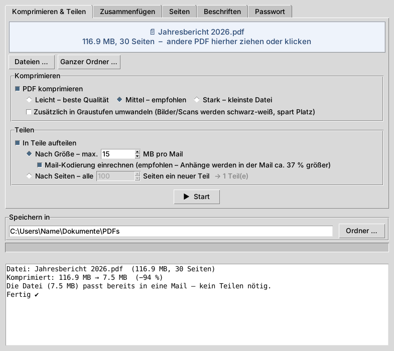
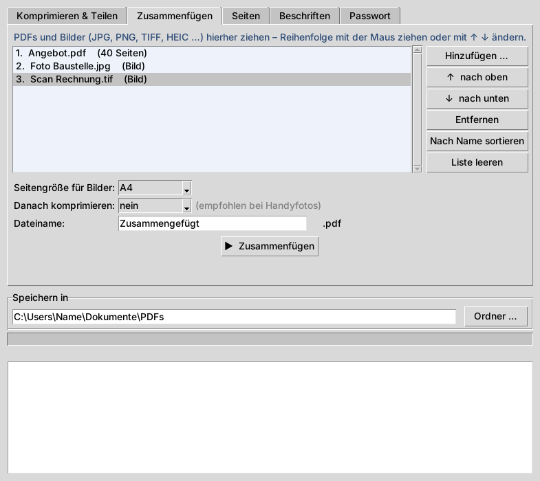

# PDF-Werkstatt

Ein kleines Programm mit Fenster für Windows und macOS, das die alltäglichen PDF-Aufgaben erledigt – **ohne Online-Dienst, alles bleibt auf dem eigenen Rechner**.

Typischer Anwendungsfall: Eine PDF mit 75 MB soll per E-Mail verschickt werden, der Empfänger nimmt aber nur 15 MB pro Mail an. PDF-Werkstatt komprimiert die Datei und/oder teilt sie automatisch in passende Teile.



## Funktionen

| Reiter | Was es kann |
|---|---|
| **Komprimieren & Teilen** | Komprimieren in 3 Stufen (Leicht / Mittel / Stark), optional in Graustufen · Teilen **nach Größe** (z. B. max. 15 MB pro Mail – der Aufschlag durch die Mail-Kodierung wird eingerechnet) oder **nach Seiten** (z. B. alle 100 Seiten) · **Stapelverarbeitung**: mehrere PDFs oder ganzen Ordner auf einmal |
| **Zusammenfügen** | Mehrere PDFs **und Bilder** (JPG, PNG, TIFF, HEIC, WEBP …) zu einer PDF · Reihenfolge per Maus ziehen · Handyfotos werden automatisch richtig gedreht · optional danach komprimieren |
| **Seiten** | Seiten herausziehen, löschen oder drehen – Angaben wie `1-3, 7, 10-` |
| **Beschriften** | Seitenzahlen (verschiedene Formate/Positionen, z. B. Deckblatt ohne Nummer) · Wasserzeichen wie „VERTRAULICH“ oder „ENTWURF“ |
| **Passwort** | Passwortschutz setzen (AES-256) oder bei eigenen PDFs entfernen |

Dateien lassen sich einfach **per Drag & Drop** ins Fenster ziehen. Das Original wird **nie verändert** – es entsteht immer eine neue Datei.



## Installation und Start

1. **Python 3** installieren: <https://www.python.org/downloads/>
   *Windows:* beim Installieren unbedingt **„Add python.exe to PATH“** anhaken.
2. Dieses Projekt herunterladen: oben rechts auf **Code → Download ZIP**, dann entpacken.
3. Starten:
   - **Windows:** Doppelklick auf `Starten_Windows.bat`
     (Tipp: eine PDF direkt auf die Datei ziehen öffnet sie gleich im Programm)
   - **macOS:** Rechtsklick auf `Starten_Mac.command` → **Öffnen** (beim ersten Mal nötig)

Beim ersten Start werden die benötigten Bibliotheken automatisch installiert.

Für Entwickler:

```bash
pip install -r requirements.txt
python pdf_werkstatt.py
```

## Kommandozeile

Komprimieren und Teilen funktioniert auch ohne Fenster:

```bash
python pdf_werkstatt.py Datei.pdf --komprimieren mittel --teilen 15     # max. 15 MB pro Mail
python pdf_werkstatt.py Datei.pdf --komprimieren stark --graustufen
python pdf_werkstatt.py Datei.pdf --seiten 100                          # alle 100 Seiten ein Teil
python pdf_werkstatt.py --help
```

## Gut zu wissen

- **Mail-Kodierung:** E-Mail-Anhänge werden beim Versand ca. 37 % größer. Mit der (standardmäßig aktiven) Option „Mail-Kodierung einrechnen“ werden die Teile bei 15 MB Limit max. ca. 10,9 MB groß – so kommen sie sicher an.
- **Komprimieren** verkleinert nur Bilder; Text bleibt durchsuchbar und kopierbar. Reine Text-PDFs lassen sich kaum verkleinern – dann wird das Original verwendet.
- Eine einzelne Seite wird nie zerschnitten. Ist eine Seite allein größer als das Limit, gibt es eine Warnung.
- Passwortgeschützte PDFs müssen erst im Reiter „Passwort“ entsperrt werden.

Ausführliche Bedienungsanleitung: [LIESMICH.txt](LIESMICH.txt)

## Getestet

Das Programm wurde mit 36 Szenarien geprüft – u. a. 117-MB- und 1000-Seiten-PDFs, Formulare, CMYK- und transparente Bilder, gedrehte/beschnittene Seiten, verschiedene Verschlüsselungen, defekte Dateien und Dateinamen mit Umlauten. Ergebnisse: [PRUEFBERICHT.txt](PRUEFBERICHT.txt)

## Verwendete Bibliotheken

[pikepdf](https://github.com/pikepdf/pikepdf) (MPL-2.0) · [Pillow](https://python-pillow.org) (MIT-CMU) · [ReportLab](https://www.reportlab.com/opensource/) (BSD) · [tkinterdnd2](https://github.com/Eliav2/tkinterdnd2) (MIT) · optional [pillow-heif](https://github.com/bigcat88/pillow_heif) (BSD-3)

## Lizenz

[MIT](LICENSE) – frei nutzbar, veränderbar und weitergebbar.
