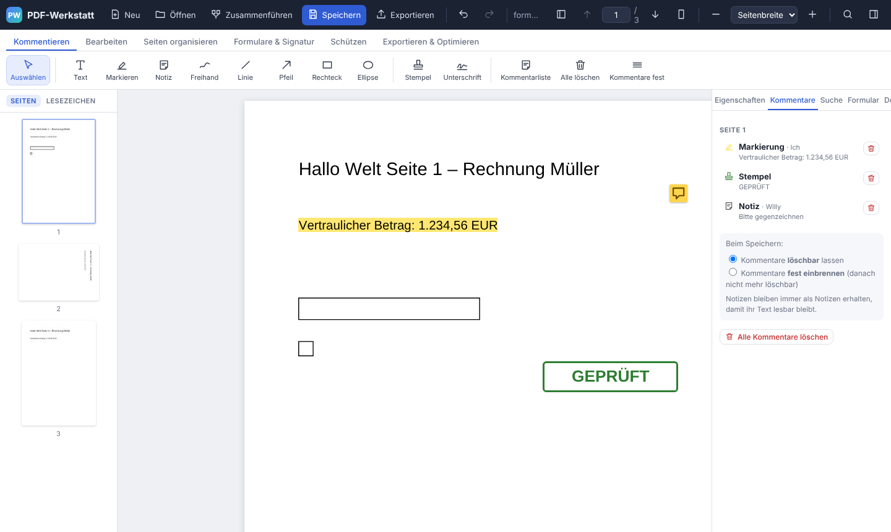

# PDF-Werkstatt

Ein PDF-Editor, der **komplett auf dem eigenen Rechner** arbeitet – ohne Upload, ohne Online-Dienst, ohne Konto.

Das Projekt gibt es in zwei Varianten:

| | **Web-App** (empfohlen) | **Desktop-Programm** |
|---|---|---|
| Start | im Browser, als App in Edge/Chrome installierbar | Python-Programm mit Fenster |
| Installation | keine (oder 1 Klick in Edge) | Python nötig |
| Funktionen | alles unten Genannte | Komprimieren, Teilen, Zusammenfügen, Seiten, Beschriften, Passwort |
| Ordner | Hauptverzeichnis | [`desktop/`](desktop/README.md) |

## Web-App starten

**Online:** <https://willy-art-ai.github.io/pdf-werkstatt/>

**Als Programm installieren (Microsoft Edge oder Chrome):**
1. Die Adresse oben öffnen.
2. Rechts in der Adressleiste auf das App-Symbol klicken („App verfügbar – installieren“) oder Menü **…** → **Apps** → **PDF-Werkstatt installieren**.
3. Optional als Standard-App für PDFs festlegen: Rechtsklick auf eine PDF → **Öffnen mit** → **Andere App auswählen** → **PDF-Werkstatt** → **Immer**.

Danach läuft die App in einem eigenen Fenster, auch **ohne Internet**. Deine PDFs werden nie hochgeladen.

## Funktionen der Web-App

- **Anzeigen:** schnelles Öffnen auch großer Dateien, Seitenminiaturen, Einzelseiten- oder Fließansicht, Blättern mit ▲▼ / Tastatur, Zoom, Volltextsuche, Lesezeichen
- **Kommentieren:** Textmarker (rastet auf Textzeilen ein), Notizen, Freihand, Linien, Pfeile, Formen, Stempel (auch eigene, auch aus Bildern), Unterschrift – als echte PDF-Kommentare, wahlweise **löschbar** oder **fest eingebrannt**
- **Bearbeiten:** vorhandenen Text ändern, Text und Bilder einfügen, abdecken, zuschneiden, Wasserzeichen, Kopf-/Fußzeilen und Seitenzahlen (Formate wie „- 1 -“ oder „Seite 1 von 9“, auf Wunsch ab Seite 2)
- **Seiten organisieren:** per Drag & Drop sortieren, drehen, löschen, duplizieren, einfügen, extrahieren, PDFs und Bilder zusammenführen – auch per Bereichsangabe wie `1-3, 7, 10-`
- **Doppelte und leere Seiten finden:** z. B. Gutachten, die mehrfach als E-Mail-Anhang in einer Akte stecken – Vergleich nach Text (alle Zahlen exakt), gescannte Seiten per Texterkennung; Ergebnisliste mit Vorschau, das erste Vorkommen bleibt immer erhalten
- **Komprimieren & teilen:** 3 Stufen (+ „Extrem“), optional Graustufen; Teilen **nach Größe** (z. B. max. 15 MB pro Mail, Mail-Kodierung eingerechnet), **in gleich große Teile** oder **nach Seiten** (z. B. alle 100 Seiten)
- **Stapelverarbeitung:** mehrere PDFs oder einen ganzen Ordner auf einmal komprimieren und/oder teilen
- **Formulare:** ausfüllen, eigene Felder anlegen, reduzieren – Felder bleiben auch nach Teilen und Zusammenführen ausfüllbar
- **Schützen:** Passwortschutz mit AES-256 setzen oder entfernen, Schwärzen (endgültig), Metadaten bearbeiten/entfernen
- **Texterkennung (OCR):** gescannte Seiten durchsuchbar machen (Deutsch/Englisch, läuft lokal)
- **Exportieren:** als Bilder (PNG/JPG), als Text; Bilder (JPG, PNG, GIF, WEBP …) zu PDF – Handyfotos werden automatisch richtig gedreht

## Datenschutz

Alles läuft im Browser auf deinem Gerät. Von GitHub wird nur das Programm selbst geladen; deine Dateien verlassen den Rechner nicht. Selbst prüfen: Internet ausschalten, PDF öffnen, bearbeiten, speichern – es funktioniert.

## Getestet

Die Web-App wurde mit **37 automatisierten Szenarien** geprüft – u. a. eine 90-MB-Foto-PDF, 250- und 400-seitige PDFs, Handyfotos in allen Drehlagen, 16-Bit-PNG, animierte GIFs, HEIC/TIFF, CMYK-Bilder, Formulare, vier Verschlüsselungsarten, defekte Dateien, Umlaute und chinesische Zeichen im Dateinamen sowie eine Akte mit mehrfach enthaltenen Gutachten. Ergebnisse: [PRUEFBERICHT-WEBAPP.md](PRUEFBERICHT-WEBAPP.md)

## Verwendete Bibliotheken

[pdf.js](https://github.com/mozilla/pdf.js) (Apache-2.0) · [pdf-lib](https://github.com/Hopding/pdf-lib) (MIT) · [JSZip](https://github.com/Stuk/jszip) (MIT) · [Tesseract.js](https://github.com/naptha/tesseract.js) mit Sprachdaten von [tessdata](https://github.com/tesseract-ocr/tessdata) (Apache-2.0) · Schriften Inter, Dancing Script, Caveat (SIL Open Font License)

## Lizenz

[MIT](LICENSE) – frei nutzbar, veränderbar und weitergebbar.
